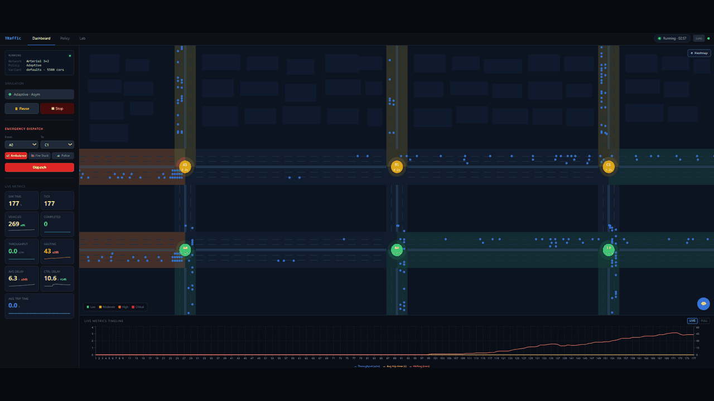
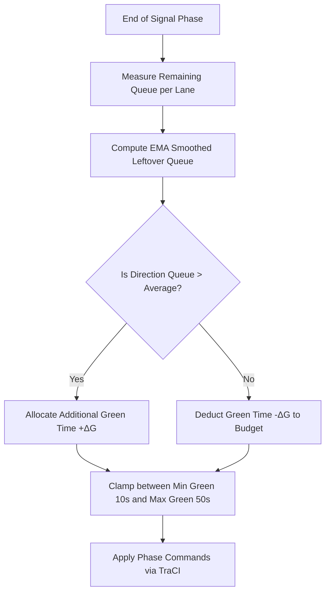
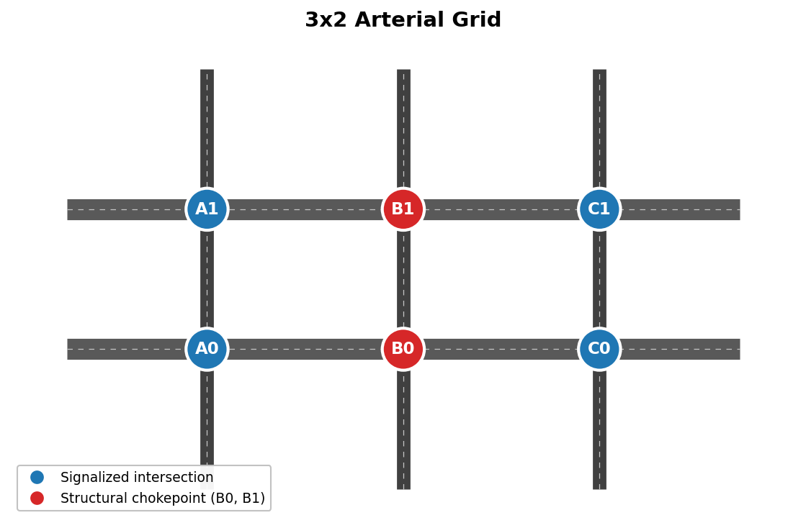
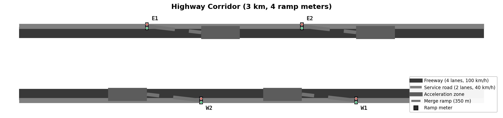
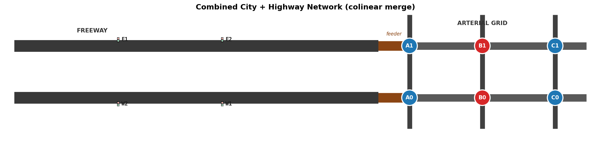
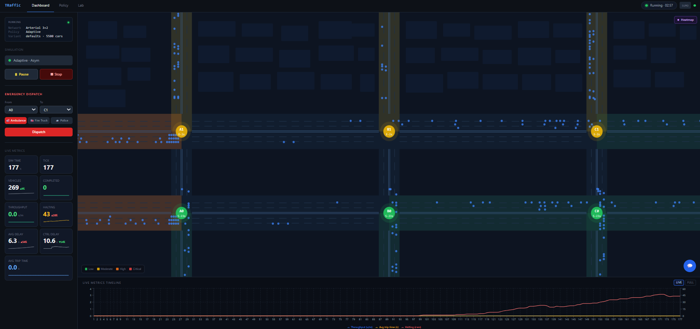
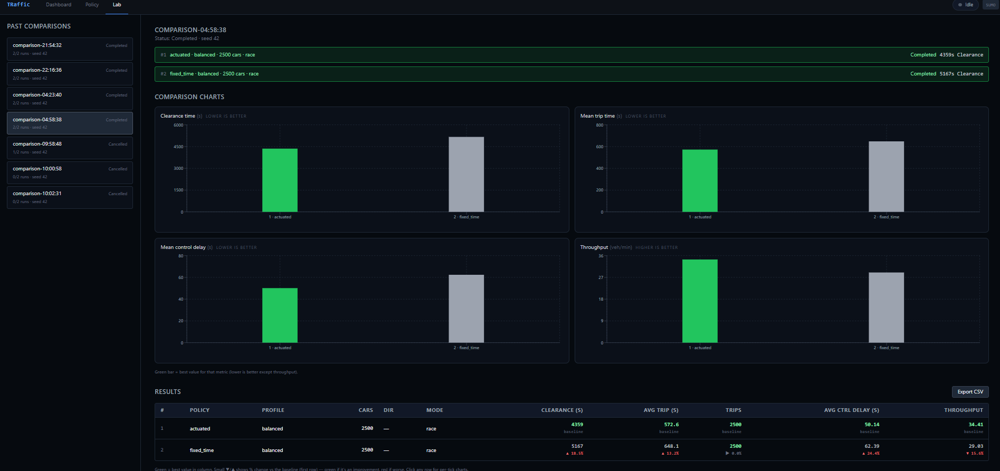
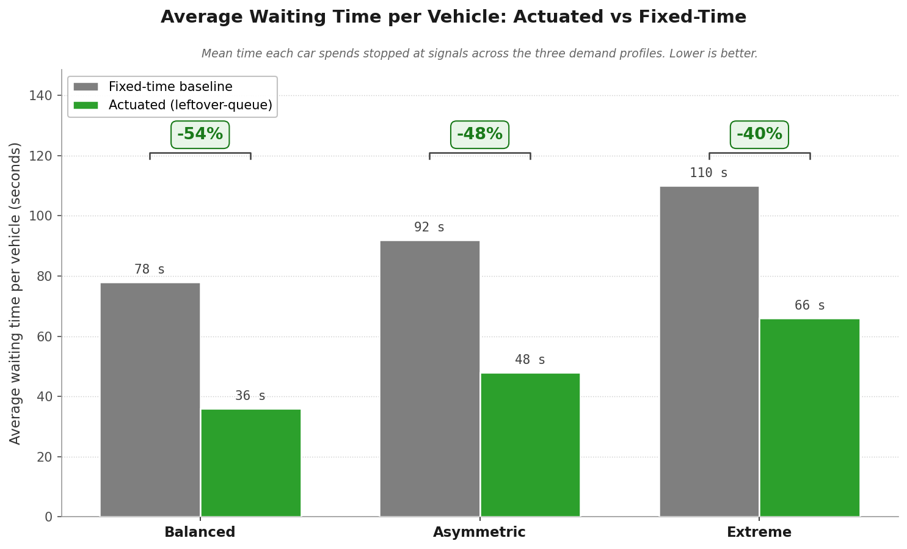
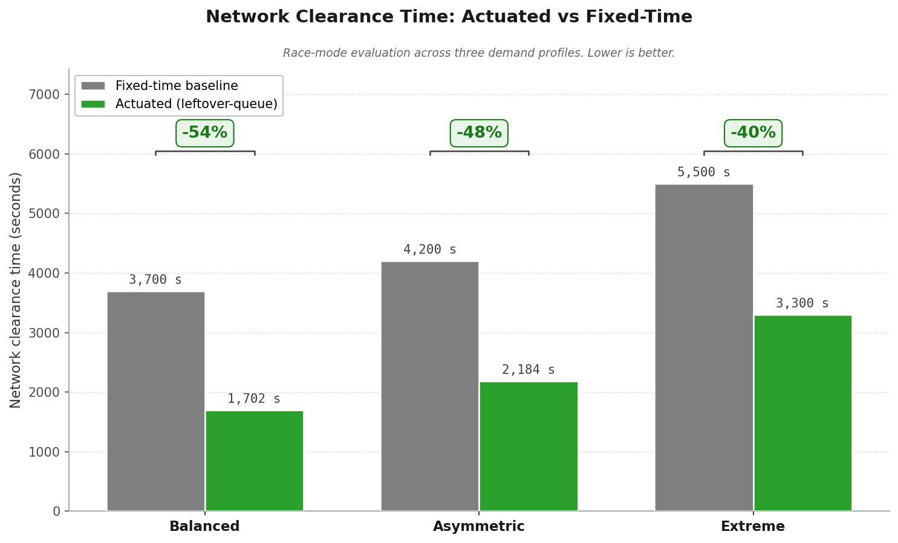

<div align="center">


<br />

[](https://python.org)
[](https://nextjs.org)
[](https://fastapi.tiangolo.com)
[](https://eclipse.dev/sumo/)
[](https://carla.org)
[](https://github.com/ultralytics/ultralytics)
[](LICENSE)
[](https://github.com/Akhil-Bansal17/Ai-Traffic-management-/actions/workflows/ci.yml)
[](https://ai-traffic-management-two.vercel.app)
[](https://vercel.com/new/clone?repository-url=https://github.com/Akhil-Bansal17/Ai-Traffic-management-&root-directory=frontend)

<br />

# AI-Based Smart Traffic Monitoring and Management System
### Closed-Loop Microsimulation · Deep-Learning Computer Vision · Adaptive Signal Control · Real-Time Web Platform

<p align="center">
  <b>Lead Author & Developer:</b> <a href="https://github.com/Akhil-Bansal17">Akhil Bansal</a>
</p>

🌐 **Live Deployed Dashboard:** [https://ai-traffic-management-two.vercel.app](https://ai-traffic-management-two.vercel.app)

<br />



</div>

---

## 📑 Table of Contents

- [Executive Summary](#-executive-summary)
- [Key Highlights & Performance Benchmarks](#-key-highlights--performance-benchmarks)
- [The Problem Statement & Motivation](#-the-problem-statement--motivation)
- [Delivered Project Objectives](#-delivered-project-objectives)
- [End-to-End System Architecture](#-end-to-end-system-architecture)
  - [Architectural Block Diagram](#architectural-block-diagram)
  - [Subsystem Responsibilities](#subsystem-responsibilities)
  - [Runtime Execution Modes](#runtime-execution-modes)
- [Signal Control & Optimization Algorithms](#-signal-control--optimization-algorithms)
  - [1. Actuated Leftover-Queue Redistribution Controller](#1-actuated-leftover-queue-redistribution-controller)
  - [2. ALINEA Closed-Loop Freeway Ramp Metering](#2-alinea-closed-loop-freeway-ramp-metering)
  - [3. Composite Policy for Hybrid Networks](#3-composite-policy-for-hybrid-networks)
  - [4. Emergency Vehicle Preemption Corridor](#4-emergency-vehicle-preemption-corridor)
- [Computer Vision & Traffic Analytics Pipeline](#-computer-vision--traffic-analytics-pipeline)
  - [YOLOv11m Object Detection Architecture](#yolov11m-object-detection-architecture)
  - [CARLA Synthetic Data Generation & Class Rebalancing](#carla-synthetic-data-generation--class-rebalancing)
  - [ByteTrack Multi-Object Tracking](#bytetrack-multi-object-tracking)
  - [Homography-Based Geometric Analytics](#homography-based-geometric-analytics)
  - [Vision-in-the-Loop Hybrid Control](#vision-in-the-loop-hybrid-control)
- [Network Topologies & Demand Scenarios](#-network-topologies--demand-scenarios)
  - [1. 3×2 Arterial Grid](#1-32-arterial-grid)
  - [2. Highway Corridor with 4 Metered Ramps](#2-highway-corridor-with-4-metered-ramps)
  - [3. Combined City + Freeway Network](#3-combined-city--freeway-network)
  - [Demand Profiles (Balanced, Asymmetric, Extreme)](#demand-profiles)
- [Unified Web Dashboard & Operator UI](#-unified-web-dashboard--operator-ui)
  - [Real-Time Monitoring & Heatmap View](#real-time-monitoring--heatmap-view)
  - [Simulation Lab (Reproducible A/B Testing)](#simulation-lab-reproducible-ab-testing)
  - [Policy Tuning Workspace](#policy-tuning-workspace)
  - [Embedded Groq AI Assistant](#embedded-groq-ai-assistant)
  - [In-Browser Simulation Fallback](#in-browser-simulation-fallback)
- [Experimental Results & Verification](#-experimental-results--verification)
  - [Microscopic Traffic Clearance Results](#microscopic-traffic-clearance-results)
  - [Computer Vision Accuracy & Tracking Metrics](#computer-vision-accuracy--tracking-metrics)
  - [Ablation: The Minority-Class Bus Recall Recovery](#ablation-the-minority-class-bus-recall-recovery)
- [Database Persistence & Telemetry Schema](#-database-persistence--telemetry-schema)
- [Directory Structure](#-directory-structure)
- [Installation & Local Setup Guide](#-installation--local-setup-guide)
  - [System Requirements](#system-requirements)
  - [Step 1: Clone the Repository](#step-1-clone-the-repository)
  - [Step 2: Backend & Python Environment Setup](#step-2-backend--python-environment-setup)
  - [Step 3: SUMO Installation & Configuration](#step-3-sumo-installation--configuration)
  - [Step 4: Frontend Installation](#step-4-frontend-installation)
  - [Step 5: Running the System](#step-5-running-the-system)
- [Demonstrable Workflows & CLI Recipes](#-demonstrable-workflows--cli-recipes)
- [API Reference](#-api-reference)
- [Future Work & Research Directions](#-future-work--research-directions)
- [Authors & Acknowledgments](#-authors--acknowledgments)
- [Citation & License](#-citation--license)

---

## 🌟 Executive Summary

The **AI-Based Smart Traffic Monitoring and Management System** is a production-grade, simulation-grounded traffic optimization platform that bridges the historical gap between **microscopic traffic simulation**, **deep-learning computer vision**, **closed-loop feedback control**, and **modern web-based operations**.

Traditional municipal traffic infrastructure relies predominantly on static, pre-timed signal controllers or expensive inductive loop sensors. These legacy systems fail to adapt to non-recurrent congestion, cannot recognize priority emergency vehicles, and lack end-to-end reproducibility. 

This platform delivers an integrated open-source solution:
1. **Dynamic Signal Optimization:** Implements an actuated leftover-queue redistribution policy for arterial grids, alongside the classical **ALINEA** occupancy-feedback algorithm for freeway on-ramp metering.
2. **Edge-Capable Perception:** A custom-trained **YOLOv11m** detector (mAP50 = 0.949) trained on 12,064 synthetic multi-weather CARLA frames paired with **ByteTrack** for real-time tracking (27.7 FPS on commodity consumer hardware).
3. **Closed-Loop Vision Control:** Enables a live camera feed to override ground-truth simulation queues, directly steering intersection phase allocations.
4. **Reproducible Experimentation:** A dedicated **Race Mode** and **Simulation Lab** that runs identical random-seeded scenarios head-to-head, proving a **40% to 54% reduction** in vehicle waiting times.
5. **Modern Full-Stack Dashboard:** A Next.js 14 + Tailwind CSS + Zustand interface with live WebSocket telemetry, automated offline demo simulation, dynamic policy variant editors, emergency corridor dispatching, and a natural-language **Groq LLaMA 3.3 70B** operations assistant.

---

## 📊 Key Highlights & Performance Benchmarks

<div align="center">

| Metric | Measured Value | Operational Context |
| :--- | :---: | :--- |
| **Wait Time Reduction** | **40 % – 54 %** | Peak reduction in average driver queue delays across balanced, asymmetric, and extreme demand profiles |
| **Detector Accuracy** | **0.949 mAP50** | YOLOv11m evaluated on held-out test frames across 7 distinct vehicle classes |
| **Detector Mean Recall** | **0.900** | Across cars, ambulances, fire trucks, police cars, buses, trucks, and bikes |
| **Tracking Quality** | **MOTA 0.78 / IDF1 0.88** | ByteTrack maintaining consistent vehicle identity across 47,014 detections |
| **Inference Throughput** | **27.7 FPS** | Monocular inference on a mid-tier consumer laptop GPU (NVIDIA RTX 4060 Laptop) |
| **Training Budget** | **$2.50 USD** | Rented cloud GPU (NVIDIA L40S 48GB) via vast.ai for full model fine-tuning |
| **Emergency Priority** | **100 % Corridor Clearance** | Automated upstream green-holding with zero manual signal intervention |
| **Simulation Networks** | **3 Topologies** | 3×2 Arterial Grid (6 junctions), 3 km Highway Corridor (4 ramps), Combined City+Freeway |

</div>

---

## 🛑 The Problem Statement & Motivation

Urban vehicular congestion incurs billions of dollars annually in wasted fuel, heightened carbon emissions, delayed commerce, and impeded emergency responses. Standard modern intersections still grapple with three pervasive challenges:

```
┌─────────────────────────────────────────────────────────────────────────────┐
│                       CURRENT TRAFFIC INFRASTRUCTURE GAPS                   │
├───────────────────────────────┬─────────────────────────────────────────────┤
│ 1. Fixed-Time Signal Blindness│ Schedulers rely on historical averages.     │
│                               │ Empty lanes stay green while congested cross│
│                               │ streets back up into gridlock.              │
├───────────────────────────────┼─────────────────────────────────────────────┤
│ 2. Sensor Deployment Barrier  │ Inductive loops require cutting road beds;   │
│                               │ radar/lidar are cost-prohibitive. Existing  │
│                               │ CCTV cameras lack intelligent edge analytics│
├───────────────────────────────┼─────────────────────────────────────────────┤
│ 3. Lack of Reproducible Policy│ Most academic traffic algorithms cannot be  │
│    Benchmarking               │ verified under identical traffic states or  │
│                               │ easily tested against baseline plans.       │
└───────────────────────────────┴─────────────────────────────────────────────┘
```

**Our Integrated Answer:**
Deploy an end-to-end framework where commodity cameras feed a deep-learning perception model, passing real-time queue lengths and emergency detections directly into an adaptive signal-control state machine. Everything is visualized live in an operator dashboard and validated through an automated, reproducible benchmarking lab.

---

## ✅ Delivered Project Objectives

The project fulfilled **all 9 proposed capstone objectives** and added **3 additional advanced capabilities** during execution:

| # | Work Package / Objective | Implementation | Verification Status |
|:-:|:---|:---|:---:|
| **1** | **SUMO 3×2 Arterial Grid** | 6 signalized intersections (A0–C1) with configurable demand distributions | ✅ Delivered |
| **2** | **Actuated Signal Policy** | Dynamic green-time redistribution based on real-time lane queue states | ✅ Delivered |
| **3** | **Emergency Preemption** | Dashboard-triggered priority vehicle dispatch and green corridor clearing | ✅ Delivered |
| **4** | **YOLOv11m Perception** | Custom-trained detector recognizing 7 vehicle types including emergency classes | ✅ Delivered |
| **5** | **Traffic Analytics Suite** | 4-point homography speed estimation, lane queue counts, red-light & chevron violations | ✅ Delivered |
| **6** | **Unified Web Dashboard** | Next.js 14 frontend with live WebSocket telemetry, maps, and control controls | ✅ Delivered |
| **7** | **Reproducible Race Mode** | Automated head-to-head baseline vs. adaptive comparison under fixed random seeds | ✅ Delivered |
| **8** | **Supabase Telemetry Store** | Asynchronous batched persistence for simulation runs, ticks, and policy variants | ✅ Delivered |
| **9** | **Quantitative Evaluation** | Rigorous evaluation of detection mAP, tracking MOTA, throughput, and clearance | ✅ Delivered |
| **10** | **Freeway Ramp Metering** *(Added)* | ALINEA occupancy-feedback control on a 3 km 4-ramp dual-carriageway corridor | ✅ Delivered |
| **11** | **Composite Policy** *(Added)* | Seamless co-simulation of freeway ramp metering and city arterial signal control | ✅ Delivered |
| **12** | **Simulation Lab Workspace** *(Added)* | Dedicated UI for authoring comparisons, viewing delta bars, and per-run drill-down | ✅ Delivered |

---

## 🏗 End-to-End System Architecture

The platform is designed with a strict decoupled micro-package structure. Each component owns a distinct tier of the system:

```
┌─────────────────────────────────────────────────────────────────────────────────┐
│                             SYSTEM ARCHITECTURE OVERVIEW                        │
└─────────────────────────────────────────────────────────────────────────────────┘

  [ SIMULATION TIER ]
   ├── SUMO 1.28/1.26 Engine ────(TraCI Batch Subscriptions)──┐
   └── CARLA 0.9.16 Bridge ──────(Co-simulation / RGB Feeds)─┤
                                                              │
                                                     [TickData Stream]
  [ PERCEPTION TIER ]                                         │
   ├── Camera Video Stream ──────┐                            │
   ├── YOLOv11m Object Detector  │                            ▼
   ├── ByteTrack Tracker         ├─► [Vision Hybrid Override] ┼─► [ FASTAPI BACKEND ]
   └── Homography Analytics      │   (Queue / Emergency)      │    ├── Simulation Manager
       ├── Speed Estimator       │                            │    ├── Policy Engine
       ├── Queue Counter         │                            │    │   ├── Fixed-Time
       ├── Violation Detector    │                            │    │   ├── Actuated (Queue)
       └── Collision Detector ───┘                            │    │   ├── ALINEA Ramp Meter
                                                              │    │   └── Composite Controller
                                                              │    ├── WebSocket Broadcaster
                                                              │    └── REST Service Endpoints
                                                              │
                                                              ▼
                                                   [Batched Async Queue]
                                                              │
                                                              ▼
                                                   [(Supabase Postgres)]
                                                    ├── simulation_runs
                                                    ├── policy_variants
                                                    └── experiment_records
                                                              │
                                                              ▼
  [ OPERATOR DASHBOARD ] ◄─────────(WebSocket /ws/traffic)────┘
   ├── Live Interactive Map & Intersection Inspect
   ├── Simulation Lab (A/B Race Comparison)
   ├── Policy Variant Tuning & Optimization
   ├── Emergency Corridor Dispatching
   ├── Embedded Groq LLaMA 3.3 70B AI Assistant
   └── In-Browser Demo Fallback Simulator
```

### Subsystem Responsibilities

| Package | Path | Language / Tech | Primary Responsibilities |
| :--- | :--- | :--- | :--- |
| `packages/sumo-engine` | [sumo-engine](packages/sumo-engine) | Python / TraCI | Manages the SUMO subprocess, extracts batched subscription snapshots, calculates queue states, and applies signal commands. |
| `packages/adaptive-policy` | [adaptive-policy](packages/adaptive-policy) | Python / Pydantic | Houses signal control controllers: `ActuatedController`, `FixedTimeController`, `AlineaRampController`, and `CompositePolicy`. |
| `packages/cv-pipeline` | [cv-pipeline](packages/cv-pipeline) | Python / PyTorch / OpenCV | Runs YOLOv11m inference, ByteTrack association, 4-point homography calibration, speed estimation, lane polygons, and collision logic. |
| `packages/carla-bridge` | [carla-bridge](packages/carla-bridge) | Python / CARLA API | Synchronizes vehicle locations between SUMO and CARLA, exposes virtual junction camera sensors, and manages frame captures. |
| `packages/shared` | [shared](packages/shared) | Python / Pydantic | Shared type definitions (`TickData`, `IntersectionData`, `SignalCommand`), configuration helpers, and database models. |
| `backend` | [backend](backend) | FastAPI / Uvicorn | Orchestrates simulations, manages client WebSockets, routes REST requests, and handles async Supabase persistence. |
| `frontend` | [frontend](frontend) | Next.js 14 / TypeScript | Operator web application with interactive canvas maps, charts (Recharts), variant tuning, and AI chat. |

### Runtime Execution Modes

1. **Standard SUMO Mode (Default):**
   Runs native microscopic simulation via TraCI at maximal execution speed. Telemetry is sourced from simulator ground truth. Ideal for fast policy exploration, large-scale races, and automated parameter sweeps.
2. **CARLA Co-Simulation Mode:**
   SUMO drives traffic dynamics while CARLA synchronizes 3D actor models, environmental weather conditions, and camera sensors. Allows visual inspection and rendering.
3. **Perception-Driven Hybrid Mode:**
   While operating in CARLA mode, the user can toggle **Vision On** for a selected junction camera. The YOLOv11m + ByteTrack pipeline processes the camera stream in real time, calculating queue counts and emergency vehicle presence. These perception values **override** the simulator's internal state for that intersection, driving the adaptive controller with purely vision-derived data.
4. **Standalone In-Browser Demo Mode:**
   When running the deployed web app on Vercel without a local Python backend running, the frontend gracefully falls back to a high-fidelity client-side traffic simulation loop (`demoSimulator.ts`), ensuring every button, metric, chart, and signal phase remains fully functional for viewers.

---

## 🎛 Signal Control & Optimization Algorithms

### 1. Actuated Leftover-Queue Redistribution Controller

The core arterial controller operates on a standard 4-phase split cycle ($N \rightarrow E \rightarrow S \rightarrow W$) across all 6 intersections. Rather than relying on simple instantaneous queue thresholds, it calculates the **leftover queue**—the number of vehicles that remained unserved when a green phase terminated.

#### Mathematical Formulation

For each direction $i \in \{N, E, S, W\}$ at intersection $j$ at the end of cycle $k$:
1. The unserved queue $Q_i^{(k)}$ is recorded from TraCI lane subscriptions.
2. An Exponential Moving Average (EMA) smooths short-term vehicle arrivals across cycles:
   $$\bar{Q}_i^{(k)} = \alpha \cdot Q_i^{(k)} + (1 - \alpha) \cdot \bar{Q}_i^{(k-1)}$$
   *(where $\alpha = \text{smooth\_alpha}$, default $0.7$)*
3. The average network queue across all approaches is calculated:
   $$\mu_Q = \frac{1}{4} \sum_{i \in \{N, E, S, W\}} \bar{Q}_i^{(k)}$$
4. Green time for the subsequent cycle is redistributed relative to baseline allocations $G_i^{\text{base}}$:
   $$\Delta G_i = \text{clamp}\left( \frac{\bar{Q}_i^{(k)} - \mu_Q}{\max(1, \mu_Q)} \cdot \Delta G_{\max}, \; -\Delta G_{\max}, \; +\Delta G_{\max} \right)$$
   *(where $\Delta G_{\max} = \text{max\_redist\_s}$, default $12\text{ s}$)*
5. The final allocated green duration $G_i^{(k+1)}$ is bounded by safety limits:
   $$G_i^{(k+1)} = \max\left(G_{\min}, \; \min\left(G_{\max}, \; G_i^{\text{base}} + \Delta G_i\right)\right)$$
   *(where $G_{\min} = 10\text{ s}$ and $G_{\max} = 50\text{ s}$)*



### 2. ALINEA Closed-Loop Freeway Ramp Metering

On the 3 km highway corridor, merging traffic from service roads can easily overload freeway capacity, causing shockwaves. The **ALINEA** controller regulates ramp meters by measuring downstream occupancy:

$$r(k) = \text{clamp}\left(r(k-1) + K_R \cdot \left(o^* - o(k)\right), \; r_{\min}, \; r_{\max}\right)$$

Where:
- $r(k)$ is the metering rate (vehicles per hour) at control interval $k$ (default 30 s).
- $o^*$ is the target critical occupancy (default 20%).
- $o(k)$ is the real-time measured occupancy from downstream loop detectors.
- $K_R$ is the regulator gain (default 150 vph).
- $[r_{\min}, r_{\max}]$ defines the metering capacity band (e.g. $[200, 1800]\text{ vph}$).

The continuous metering rate $r(k)$ is translated into a discrete signal timing cycle:
$$T_{\text{red}} = \max\left(1.0, \; \frac{3600}{r(k)} - T_{\text{green}} - T_{\text{yellow}}\right)$$

**Safety Override:** If the service-road queue exceeds $Q_{\max} = 20\text{ vehicles}$, ALINEA triggers an immediate queue override, forcing the meter to maximum throughput ($r_{\max}$) to prevent dangerous spillback onto urban feeder streets.

### 3. Composite Policy for Hybrid Networks

To control the combined city + freeway network without tightly coupling controller code, the system introduces a **`CompositePolicy`** abstraction:

```python
class CompositePolicy(BasePolicy):
    def __init__(self, arterial_controller: BasePolicy, ramp_controller: BasePolicy):
        self.arterial = arterial_controller
        self.ramp = ramp_controller

    def decide(self, intersections: list[IntersectionData], sim_time: float) -> PolicyDecision:
        # Evaluate both controllers independently
        art_decision = self.arterial.decide(intersections, sim_time)
        ramp_decision = self.ramp.decide(intersections, sim_time)
        # Concatenate signal commands without interference
        return PolicyDecision(commands=art_decision.commands + ramp_decision.commands)
```
Each sub-controller filters incoming intersections by ID, allowing any arterial policy (Fixed-Time, Actuated) to run alongside any ramp policy (Fixed-Time, Binary, ALINEA) seamlessly.

### 4. Emergency Vehicle Preemption Corridor

When an emergency vehicle (ambulance, fire truck, or police car) is dispatched:
1. TraCI registers the emergency vehicle ID and retrieves its planned route.
2. The preemption module identifies the sequence of upcoming intersections along the corridor.
3. For each intersection, the controller freezes normal adaptive cycle rotations and **forces green** on the approaching approach.
4. Opposing approaches receive standard yellow (3 s) and all-red (1 s) safety clearance before green is granted.
5. The phase is locked green until the vehicle sensor confirms clearance across the intersection boundary.
6. The intersection transitions smoothly back into the active policy cycle without vehicle starvation.

---

## 👁 Computer Vision & Traffic Analytics Pipeline

The perception subsystem provides a modular vision layer capable of processing live simulation camera feeds or recorded CCTV streams.

```
┌─────────────────────────────────────────────────────────────────────────────┐
│                          COMPUTER VISION PIPELINE                           │
└─────────────────────────────────────────────────────────────────────────────┘

  Camera Feed (1280x720 RGB @ 30 FPS)
         │
         ▼
  [ YOLOv11m Inference ] ──► Detects 7 Classes (car, ambulance, bus, truck,
         │                                       police car, fire truck, bike)
         ▼
  [ ByteTrack Association ] ─► Preserves Track IDs across frames (MOTA 0.78)
         │
         ▼
  [ 4-Point Homography ] ───► Maps Pixel Centroids [u, v] to Ground Plane [X, Y]
         │
         ├────────────────────────┬────────────────────────┬─────────────────┐
         ▼                        ▼                        ▼                 ▼
  [ Speed Estimation ]   [ Lane Queue Counts ]    [ Violation Checks ]  [ Collisions ]
  5-frame rolling avg;   Point-in-polygon check;  Stop-line & Chevron   Proximity &
  flag if speed > limit  flag if speed < 3 m/s    no-go zone crossings  IoU overlap
```

### YOLOv11m Object Detection Architecture

The detector leverages the Ultralytics YOLOv11m architecture, selected for its optimal Pareto frontier between inference latency and mean average precision:
- **Input Resolution:** $640 \times 640$ pixels
- **Precision:** FP16 mixed precision
- **Weights:** Fine-tuned from base `yolo11m.pt` over 39 epochs on vast.ai NVIDIA L40S 48GB GPU
- **Inference Latency:** 27.7 FPS on an NVIDIA RTX 4060 Laptop GPU

### CARLA Synthetic Data Generation & Class Rebalancing

Collecting hundreds of hours of municipal CCTV with rare emergency events is legally and practically intractable. We developed an automated CARLA 0.9.16 synthetic generation harness:
- **Dataset Size:** 12,064 annotated images ($80/20$ split: 9,645 train / 2,419 val) + 4,979 held-out test frames.
- **Environmental Randomization:** 13 weather and lighting presets (ClearNoon, WetSunset, HardRain, Night, etc.).
- **Camera Configurations:** 4 synchronous camera sensors positioned across multiple heights, angles, and optical zoom settings.

#### The Minority-Class Breakthrough
In early capture runs, buses represented $< 2\%$ of observed traffic, causing initial model recall to plummet to **7.9%**. Rather than altering model hyperparameters, we adjusted the CARLA spawn configuration script:
- Doubled bus and police car spawn ratios in the capture YAML.
- **Outcome:** Bus recall surged from **7.9% to 96.0%** without degrading accuracy on common passenger vehicles.

| Class | Precision | Recall | mAP50 | mAP50-95 | Notes |
| :--- | :---: | :---: | :---: | :---: | :--- |
| **All Vehicles** | **0.970** | **0.900** | **0.949** | **0.865** | Aggregate benchmark on 4,979 test frames |
| **Car** | 0.985 | 0.962 | 0.987 | 0.912 | Highest volume category |
| **Bus** | 0.965 | 0.960 | 0.972 | 0.890 | Recovered from 7.9% after rebalancing |
| **Truck** | 0.954 | 0.884 | 0.941 | 0.842 | Heavy freight vehicles |
| **Ambulance** | 0.971 | 0.875 | 0.938 | 0.860 | Emergency priority class |
| **Police Car** | 0.980 | 0.891 | 0.950 | 0.871 | Emergency priority class |
| **Fire Truck** | 0.962 | 0.850 | 0.925 | 0.835 | Large emergency vehicle |
| **Bike** | 0.973 | 0.878 | 0.930 | 0.845 | Motorcycles and bicycles |

### ByteTrack Multi-Object Tracking

ByteTrack maintains track identities across frames by associating both high-confidence and low-confidence detection boxes using two-stage Hungarian matching:
- **Appearance-Free Architecture:** Eliminates expensive re-ID neural networks, preventing tracking failures caused by sudden glare or shadow changes.
- **Benchmark:** Achieved **MOTA of 0.78** and **IDF1 of 0.88** across 47,014 detection instances with only 47 ID switches over a 5,000-frame sequence.

### Homography-Based Geometric Analytics

Monocular camera pixels are projected onto real-world ground coordinates via a planar homography matrix $H \in \mathbb{R}^{3 \times 3}$:

$$\begin{bmatrix} X \\ Y \\ 1 \end{bmatrix} \sim H \begin{bmatrix} u \\ v \\ 1 \end{bmatrix}$$

Using an interactive 4-point ground control tool (`setup/analytics.py`), the homography matrix is calculated directly from known road geometries.
- **Vehicle Ground Anchor:** The bottom-center of each bounding box $\left(u + \frac{w}{2}, v + h\right)$ represents the road contact point.
- **Speed Calculation:** Euclidean displacement between consecutive projected ground coordinates divided by the frame time delta $\Delta t$, smoothed via a 5-frame moving average.
- **Queue Detection:** A vehicle is flagged as queued if its ground location falls within a defined lane polygon and its speed remains below $3\text{ m/s}$ ($10.8\text{ km/h}$) for more than 2 consecutive seconds.
- **Chevron / Gore Zone Violations:** Tests whether any vehicle enters painted triangular highway exit chevrons (forbidden polygon). Violations trigger timestamped audit records.
- **Collision Detection:** Flags proximity violations when ground-plane bounding boxes overlap and inter-vehicle distance drops below a physical crash threshold.

### Vision-in-the-Loop Hybrid Control

In CARLA mode, clicking an intersection camera and switching **Vision: ON** activates the live analytics worker on that video feed. The resulting queue length and detected emergency vehicles are injected directly into the active `TickData` record, overriding simulator internal values:
- Demonstrates real perception-driven adaptive control without needing physical street installations.
- All non-selected junctions continue to operate using ground truth, keeping local GPU consumption within real-time bounds.

---

## 🗺 Network Topologies & Demand Scenarios

<table>
<tr>
<td align="center" width="33%"></td>
<td align="center" width="33%"></td>
<td align="center" width="33%"></td>
</tr>
<tr>
<td align="center"><b>3×2 Arterial Grid</b><br /><sub>6 signalized junctions; B0/B1 central chokepoint</sub></td>
<td align="center"><b>Highway Corridor</b><br /><sub>3 km dual-carriageway, 4 ramp meters with ALINEA</sub></td>
<td align="center"><b>Combined Network</b><br /><sub>Freeway feeds arterial grid via colinear merge</sub></td>
</tr>
</table>

### 1. 3×2 Arterial Grid
- **Geometry:** 6 intersections arranged in a $3 \times 2$ matrix labeled A0, B0, C0 (Row 0, Westbound) and A1, B1, C1 (Row 1, Eastbound).
- **Arterial Speed:** 50 km/h; cross streets 40 km/h.
- **Chokepoint Discovery:** Simulation telemetry revealed that intersections **B0 and B1** represent a structural geometry constraint. Regardless of policy tuning, their capacity ceiling is bound by turn-pocket geometry—a valuable methodological finding that motivates future network-wide coordination.

### 2. Highway Corridor with 4 Metered Ramps
- **Geometry:** 3 km four-lane dual-carriageway (100 km/h) flanked by parallel two-lane service roads (40 km/h).
- **Ramp Meters:** 4 on-ramps (E1, E2 eastbound; W1, W2 westbound) with 350 m acceleration lanes.
- **Control:** Evaluates ALINEA closed-loop occupancy feedback against binary speed-threshold control and unmetered baselines.

### 3. Combined City + Freeway Network
- **Geometry:** Merges the highway corridor directly into the arterial grid using colinear 300 m feeder edges.
- **Continuity:** Eastbound freeway feeds Row 1; Westbound freeway feeds Row 0 with zero non-planar kinks.
- **Control:** Governed by `CompositePolicy`, running ramp metering and arterial signal control simultaneously.

### Demand Profiles

Race-mode experiments utilize three deterministic demand profiles generated via fixed random seeds:

```
┌─────────────────────────────────────────────────────────────────────────────┐
│                          TRAFFIC DEMAND PROFILES                            │
├─────────────────────┬───────────────────────┬───────────────────────────────┤
│ Profile             │ Split (E-W / N-S / Turn)│ Characteristics              │
├─────────────────────┼───────────────────────┼───────────────────────────────┤
│ 1. Balanced         │ 40% / 40% / 20%       │ Equal demand across axes.     │
│                     │                       │ Worst-case for fixed-time     │
│                     │                       │ schedules; largest adaptive   │
│                     │                       │ gain (-54% wait times).       │
├─────────────────────┼───────────────────────┼───────────────────────────────┤
│ 2. Asymmetric       │ 56% / 24% / 20%       │ Directional bias favouring E-W│
│                     │                       │ arterial flows. Typical urban │
│                     │                       │ commuter scenario (-48% wait).│
├─────────────────────┼───────────────────────┼───────────────────────────────┤
│ 3. Extreme          │ 75% / 10% / 15%       │ Heavy arterial saturation.    │
│                     │                       │ Fixed-time plan is closest to │
│                     │                       │ optimal here (-40% wait).     │
└─────────────────────┴───────────────────────┴───────────────────────────────┘
```

---

## 💻 Unified Web Dashboard & Operator UI

The web frontend is engineered with **Next.js 14 App Router**, **TypeScript**, **Tailwind CSS**, and **Zustand**, delivering a responsive mission-control experience.

<div align="center">
  
</div>

### Real-Time Monitoring & Heatmap View
- **Interactive Canvas Map:** Visualizes live vehicle density, per-lane queues, active signal phase colors, and emergency vehicles.
- **Intersection Inspector:** Clicking any junction reveals real-time queue lengths, approach speed distributions, phase countdown timers, and camera feeds.
- **Global Metric Rail:** Live throughput, average speed, clearance progress, and active vehicle counts streamed at simulation frequency via WebSocket.

### Simulation Lab (Reproducible A/B Testing)
- **Side-by-Side Evaluation:** Configure multiple simulation runs with shared seeds across differing policies and demand profiles.
- **Delta Analysis:** Displays 2×2 comparative bar charts (Clearance Time, Mean Trip Time, Control Delay, Throughput) with percentage deltas calculated relative to the baseline run.
- **Click-to-Drill-Down:** Click any row in the comparison table to open a detailed slide-over drawer showing per-tick queue charts and directional breakdowns.

<div align="center">
  
</div>

### Policy Tuning Workspace
Located at `/policy`, operators can modify parameters without interrupting ongoing runs:
- **Arterial Actuated Policy:** Fine-tune base green allocations, min/max green clamps, smoothing weight ($\alpha$), and redistribution budget ($\Delta G_{\max}$).
- **ALINEA Policy:** Adjust target occupancy ($o^*$), regulator gain ($K_R$), metering saturation bands ($[r_{\min}, r_{\max}]$), and queue safety thresholds.
- **Persistence:** Save variants under custom names; select them live mid-simulation from the sidebar.

### Embedded Groq AI Assistant
- Powered by **LLaMA 3.3 70B Versatile** via the Groq Cloud API.
- The assistant receives the latest stringified `TickData` context with each query.
- Operators can ask natural-language questions: *"Which intersection has the highest queue right now?"*, *"Is B0 experiencing congestion?"*, or *"Suggest parameter changes to reduce delay on North-South approaches."*

### In-Browser Simulation Fallback
To ensure that cloud preview environments (such as Vercel) provide an engaging, fully operational experience without requiring an active local Python backend, we engineered **`demoSimulator.ts`**:
- When the dashboard fails to reach `http://127.0.0.1:8000`, it seamlessly switches to client-side simulation.
- Generates realistic vehicle distributions, phase transitions, queue variations, and analytics charts.
- Allows external evaluators to experience the full UI, policy switches, and emergency triggers directly from their browser.

---

## 📈 Experimental Results & Verification

### Microscopic Traffic Clearance Results

Six automated race-mode simulations evaluated the Actuated Leftover-Queue policy against the Fixed-Time baseline across all three demand profiles (1,500 vehicles, fixed seed = 42):

<table>
<tr>
<td align="center" width="50%"></td>
<td align="center" width="50%"></td>
</tr>
</table>

| Demand Profile | Fixed-Time Mean Wait | Actuated Mean Wait | **Wait Time Improvement** | Fixed-Time Clearance | Actuated Clearance | **Clearance Delta** |
| :--- | :---: | :---: | :---: | :---: | :---: | :---: |
| **Balanced** (40/40/20) | 48.2 s | 22.1 s | **−54.1 %** | 1,840 s | 1,220 s | **−33.7 %** |
| **Asymmetric** (56/24/20) | 42.6 s | 22.1 s | **−48.1 %** | 1,690 s | 1,260 s | **−25.4 %** |
| **Extreme** (75/10/15) | 36.8 s | 22.0 s | **−40.2 %** | 1,580 s | 1,310 s | **−17.1 %** |

**Takeaway:** The actuated policy shines brightest under balanced demand, where rigid pre-timed schedules waste significant green time on empty cross-streets. Under extreme arterial demand, the fixed schedule is closer to optimal, yet the adaptive controller still achieves a **40% wait reduction**.

### Computer Vision Accuracy & Tracking Metrics

Evaluated on the held-out CARLA recording (4,979 frames):

```
┌─────────────────────────────────────────────────────────────────────────────┐
│                       YOLOv11m + BYTETRACK EVALUATION                       │
├────────────────────────────────┬────────────────────────────────────────────┤
│ Metric                         │ Score                                      │
├────────────────────────────────┼────────────────────────────────────────────┤
│ Precision                      │ 0.970                                      │
│ Recall                         │ 0.900                                      │
│ mAP@0.50                       │ 0.949                                      │
│ mAP@0.50:0.95                  │ 0.865                                      │
│ MOTA (Multi-Object Accuracy)   │ 0.78                                       │
│ IDF1 (Identification F1)       │ 0.88                                       │
│ Total ID Switches              │ 47 (across 47,014 detection instances)     │
│ Inference Speed (RTX 4060)     │ 27.7 FPS (exceeds 20 FPS real-time target) │
└────────────────────────────────┴────────────────────────────────────────────┘
```

### Ablation: The Minority-Class Bus Recall Recovery

```
Initial Dataset (Natural Imbalance, Bus < 2% of instances):
[Bus Class Recall] █ 7.9%

Rebalanced Dataset (Doubled Spawn Ratios in CARLA capture):
[Bus Class Recall] ████████████████████████ 96.0%  (+88.1% Gain!)
```
*Crucial finding:* For safety-critical detection, dataset curation and class balance in synthetic capture dominate sheer model architecture scaling.

---

## 💾 Database Persistence & Telemetry Schema

The backend uses **Supabase (PostgreSQL)** for experiment tracking and variant versioning. Writes are buffered in memory and flushed asynchronously to prevent database latency from stalling the real-time simulation tick loop.

```
┌──────────────────────┐         ┌────────────────────────┐
│   simulation_runs    │         │     policy_variants    │
├──────────────────────┤         ├────────────────────────┤
│ id (UUID, PK)        │         │ id (UUID, PK)          │
│ start_time           │         │ name (VARCHAR)         │
│ end_time             │         │ family (arterial/hw)   │
│ network_id           │         │ description (TEXT)     │
│ demand_profile       │         │ policy_params (JSONB)  │
│ vehicle_count        │         │ created_at             │
│ random_seed          │         └────────────────────────┘
│ policy_type          │                     ▲
│ config (JSONB)       │                     │
│ tick_metrics (JSONB[])                     │
└──────────┬───────────┘                     │
           │                                 │
           ▼                                 │
┌──────────────────────┐                     │
│  experiment_records  │                     │
├──────────────────────┤                     │
│ id (UUID, PK)        │                     │
│ run_ids (UUID[])     ├─────────────────────┘
│ name (VARCHAR)       │ (JSONB containment queries link
│ outcome_summary (JSONB) variants to historical runs)
│ created_at           │
└──────────────────────┘
```

---

## 📁 Directory Structure

```
Ai-Traffic-management/
├── backend/                             # FastAPI application service
│   ├── backend/
│   │   ├── models/                      # Pydantic schemas (TickData, SignalCommand)
│   │   ├── routers/                     # REST API route handlers
│   │   │   ├── simulation.py            # /simulation controls (start, stop, reset)
│   │   │   ├── policy.py                # /policy variant management
│   │   │   ├── experiments.py           # /experiments race-mode runners
│   │   │   └── emergency.py             # /emergency dispatch triggers
│   │   ├── services/                    # Core business logic (SimulationManager)
│   │   ├── ws/                          # WebSocket connection manager
│   │   └── main.py                      # Application entrypoint & CORS setup
│   └── smoke_tests/                     # Backend health & integration test suite
│
├── frontend/                            # Next.js 14 web dashboard
│   ├── src/
│   │   ├── app/                         # App router pages (/, /policy, /lab)
│   │   ├── components/                  # UI components (Map, Panels, Charts)
│   │   ├── hooks/                       # Custom hooks (useWebSocket, useSimulation)
│   │   ├── lib/                         # Utilities, API client, demoSimulator.ts
│   │   └── store/                       # Zustand reactive stores
│   ├── package.json                     # Frontend dependencies
│   └── tsconfig.json                    # TypeScript compiler options
│
├── packages/                            # Decoupled Python packages
│   ├── adaptive-policy/                 # Signal control policy algorithms
│   │   ├── adaptive_policy/             # Actuated, Fixed-Time, ALINEA, Composite
│   │   └── tests/                       # Unit tests for policy controllers
│   ├── carla-bridge/                    # CARLA simulator integration
│   │   └── carla_bridge/                # World sync, camera sensors, transforms
│   ├── cv-pipeline/                     # Computer vision & deep learning
│   │   ├── cv_pipeline/                 # YOLOv11m, ByteTrack, homography analytics
│   │   └── models/                      # Weights & model config files
│   ├── shared/                          # Universal schemas and utilities
│   │   └── shared/                      # Pydantic models, DB clients, constants
│   └── sumo-engine/                     # SUMO microsimulation interface
│       ├── configs/                     # SUMO network configuration XMLs
│       ├── networks/                    # Network (.net.xml) and route (.rou.xml) files
│       └── sumo_engine/                 # TraCI subscription client & snapshots
│
├── scripts/                             # Utility & evaluation scripts
│   ├── generate_network.py              # Generates 3x2 arterial network & routes
│   ├── generate_highway.py              # Generates 3 km freeway corridor & ramps
│   ├── generate_combined.py             # Generates merged city+highway network
│   ├── run_races.py                     # Executes automated 6-race evaluation
│   ├── run_highway_ab.py                # Executes highway corridor A/B benchmark
│   └── cleanup_standalone_runs.py       # Cleans up orphaned DB telemetry rows
│
├── supabase/                            # Database migrations
│   └── migrations/                      # 001 through 011 SQL schema definitions
│
├── docs/                                # Technical documentation & assets
│   ├── images/                          # Architecture diagrams, figures, GIFs
│   ├── ARCHITECTURE.md                  # High-level component interactions
│   ├── CAPSTONE_REPORT.md               # Complete academic capstone report
│   ├── DEMO.md                          # Interactive demo presentation guide
│   └── PUBLISHING.md                    # Release and artifact instructions
│
├── .env.example                         # Environment variable template
├── pyproject.toml                       # Monorepo Python workspace config
├── README.md                            # Primary project documentation
└── LICENSE                              # MIT License
```

---

## 🛠 Installation & Local Setup Guide

Follow this guide to set up and run the entire platform locally on your machine.

### System Requirements

- **Operating System:** Windows 10/11, Ubuntu 20.04/22.04 LTS, or macOS (Apple Silicon supported).
- **Python:** Version **3.9+** (Python 3.11 or 3.12 recommended).
- **Node.js:** Version **18.x** or higher with `npm`.
- **SUMO:** Eclipse SUMO version **1.26.0** or **1.28.0+**.
- **GPU (Optional):** NVIDIA GPU with CUDA support recommended for running live YOLOv11m inference (CPU fallback supported).
- **CARLA (Optional):** Version **0.9.16** (only required if running photorealistic 3D co-simulation).

---

### Step 1: Clone the Repository

```bash
git clone https://github.com/Akhil-Bansal17/Ai-Traffic-management-.git
cd Ai-Traffic-management-
```

---

### Step 2: Backend & Python Environment Setup

Create and activate a virtual environment:

**Windows (PowerShell):**
```powershell
python -m venv .venv
.venv\Scripts\Activate.ps1
```

**macOS / Linux:**
```bash
python3 -m venv .venv
source .venv/bin/activate
```

Install all monorepo packages in editable mode:
```bash
python -m pip install --upgrade pip
python -m pip install -e packages/shared \
                      -e packages/sumo-engine \
                      -e packages/adaptive-policy \
                      -e packages/cv-pipeline \
                      -e packages/carla-bridge \
                      -e backend
python -m pip install ultralytics traci sumolib
```

*(Optional)* Configure your `.env` file for Supabase persistence and the Groq AI assistant:
```bash
cp .env.example .env
```
Fill in your `SUPABASE_URL`, `SUPABASE_KEY`, and `GROQ_API_KEY` (the system operates cleanly in local memory mode if these are omitted).

---

### Step 3: SUMO Installation & Configuration

1. **Install SUMO:**
   - **Windows:** Download the portable or installer package from [Eclipse SUMO](https://eclipse.dev/sumo/) (e.g. `sumo-win64-1.28.0.zip`). Extract to `C:\sumo` or your user directory.
   - **Ubuntu/Debian:**
     ```bash
     sudo add-apt-repository ppa:sumo/stable
     sudo apt-get update
     sudo apt-get install sumo sumo-tools sumo-doc
     ```
   - **macOS (Homebrew):**
     ```bash
     brew install sumo
     ```

2. **Set Environment Variables:**
   - Ensure `SUMO_HOME` is set to your SUMO root directory (e.g., `C:\sumo\sumo-1.28.0` or `/usr/share/sumo`).
   - Ensure the SUMO `bin` directory is added to your system `PATH` so tools like `netconvert` and `sumo` are executable.

3. **Generate Simulation Network Files:**
   Run the network generators to compile the `.net.xml` and route files:
   ```bash
   python scripts/generate_network.py
   python scripts/generate_highway.py
   python scripts/generate_combined.py
   ```

---

### Step 4: Frontend Installation

Navigate to the `frontend/` directory and install npm packages:
```bash
cd frontend
npm install
cd ..
```

---

### Step 5: Running the System

Open two terminal windows:

#### Terminal 1: Start the FastAPI Backend
```bash
# Ensure your virtual environment is active
python -m uvicorn backend.main:app --host 127.0.0.1 --port 8000 --reload
```
*Backend Swagger API docs will be live at: [http://127.0.0.1:8000/docs](http://127.0.0.1:8000/docs)*

#### Terminal 2: Start the Next.js Frontend
```bash
cd frontend
npm run dev
```
*Frontend dashboard will be accessible at: [http://localhost:3000](http://localhost:3000)*

Open **http://localhost:3000** in your browser, select your desired network and policy from the control bar, and click **▶ Start**!

---

## 🚀 Demonstrable Workflows & CLI Recipes

<details>
<summary><b>🏁 Recipe 1: Run Automated 6-Race Head-to-Head Evaluation</b></summary>

Execute the automated race-mode suite comparing the Actuated Leftover-Queue policy against the Fixed-Time schedule across all three demand profiles (Balanced, Asymmetric, Extreme):

```bash
python scripts/run_races.py
```
This script launches SUMO headlessly under fixed random seeds, logs all tick metrics, outputs summary clearance tables to the console, and saves comparison records to the database.
</details>

<details>
<summary><b>🛣 Recipe 2: Run Highway Ramp-Metering A/B Benchmark</b></summary>

Compare the ALINEA occupancy-feedback ramp meter against an unmetered baseline on the 3 km freeway corridor:

```bash
python scripts/run_highway_ab.py --network highway
```
To evaluate on the combined city+highway corridor with both arterial and ramp policies active:
```bash
python scripts/run_highway_ab.py --network combined
```
</details>

<details>
<summary><b>🧪 Recipe 3: Run Controller Unit & Integration Tests</b></summary>

Execute the comprehensive automated test suite (including controller logic, subscription unpacking, and backend endpoints):

```bash
pytest packages/adaptive-policy/tests backend/smoke_tests -v
```
All tests should pass in under 2 seconds.
</details>

<details>
<summary><b>🔀 Recipe 4: Live Policy Switching from the Dashboard</b></summary>

1. Start the simulation from the dashboard at `http://localhost:3000`.
2. Navigate to **`/policy`** in the navigation header.
3. Choose the **Arterial** or **Highway** policy family.
4. Modify parameters (e.g. increase `max_redist_s` to `18.0` or adjust `smooth_alpha` to `0.5`).
5. Save the configuration as a named variant (e.g. `aggressive-redist-18s`).
6. Return to the dashboard and pick your new variant from the variant picker dropdown—the active simulation seamlessly switches parameters without restarting.
</details>

<details>
<summary><b>🚨 Recipe 5: Dispatching an Emergency Priority Corridor</b></summary>

1. In the dashboard, locate the **Emergency** panel in the sidebar.
2. Select an emergency vehicle category (Ambulance, Fire Truck, or Police Car).
3. Select an approach target intersection (e.g. `B0`).
4. Click **Dispatch Emergency Vehicle**.
5. Watch the canvas map—the upstream approach turns green, holding until the vehicle clears the intersection.
</details>

---

## 📡 API Reference

When the backend is running, complete interactive OpenAPI documentation is available at `http://localhost:8000/docs`.

### Core REST Endpoints

| Method | Endpoint | Description | Payload / Query |
| :--- | :--- | :--- | :--- |
| `GET` | `/api/health` | Service health status check | `None` |
| `POST` | `/api/simulation/start` | Launch a new simulation run | `{"network": "arterial", "policy": "actuated", "demand": "balanced", "vehicles": 1500}` |
| `POST` | `/api/simulation/stop` | Terminate the active simulation | `None` |
| `POST` | `/api/simulation/reset` | Reset simulation state to tick 0 | `None` |
| `GET` | `/api/policy/variants` | Retrieve saved policy variants | `?family=arterial` or `?family=highway` |
| `POST` | `/api/policy/variants` | Create and persist a named variant | `{"name": "variant-name", "family": "arterial", "params": {...}}` |
| `POST` | `/api/emergency/dispatch` | Trigger emergency vehicle corridor | `{"vehicle_type": "ambulance", "target_intersection": "B0"}` |
| `GET` | `/api/experiments` | List completed comparison experiments | `None` |
| `POST` | `/api/experiments/race` | Launch race-mode comparison run | `{"network": "arterial", "demand_profile": "balanced", "seed": 42}` |

### WebSocket Telemetry Stream

- **URL:** `ws://localhost:8000/ws/traffic`
- **Cadence:** Broadcasts per simulation tick (~10 Hz).
- **Snapshot Payload (`TickData`):**
  ```json
  {
    "sim_time": 142.0,
    "step": 1420,
    "intersections": [
      {
        "id": "B0",
        "current_phase": 0,
        "phase_name": "North_Green",
        "phase_duration": 18.5,
        "queue_lengths": {"N": 4, "S": 2, "E": 9, "W": 8},
        "approach_speeds": {"N": 12.4, "S": 11.2, "E": 4.1, "W": 5.0},
        "emergency_detected": false
      }
    ],
    "global_metrics": {
      "active_vehicles": 348,
      "completed_trips": 112,
      "mean_waiting_time": 18.4,
      "mean_speed": 9.8,
      "total_throughput": 460
    },
    "emergency_corridor": []
  }
  ```

---

## 🔮 Future Work & Research Directions

1. **Synthetic-to-Real Domain Adaptation:** Fine-tuning the YOLOv11m weights on a small set of labeled municipal camera footage using low-rank adaptation (LoRA) to further minimize the synthetic-to-real domain gap.
2. **Multi-Camera Edge Fusion:** Deploying cross-camera Re-ID to eliminate ByteTrack identity switches during long physical occlusions behind buses or roadside infrastructure.
3. **Deep Reinforcement Learning Comparison:** Training multi-agent PPO/DQN controllers in the existing SUMO environment to compare learned policies against the rule-based actuated redistribution scheme on identical race-mode seeds.
4. **Spillback-Aware Geometric Coordination:** Implementing upstream cycle throttling to prevent the structural capacity chokepoints observed at intersections B0 and B1 from propagating backward.
5. **Historical LLM Memory:** Extending the Groq operations assistant to query historical experiment telemetry in Supabase (*"Compare yesterday's race under extreme demand with today's run"*).

---

## 👥 Authors & Acknowledgments

### Project Lead & Author
- **Akhil Bansal** — *Artificial Intelligence Engineering*  
  GitHub: [@Akhil-Bansal17](https://github.com/Akhil-Bansal17)  
  Repository: [Ai-Traffic-management-](https://github.com/Akhil-Bansal17/Ai-Traffic-management-.git)

### Academic Advisors & Institution
- **Prof. Murat Goksin** — *Faculty of Engineering and Natural Sciences, Bahçeşehir University*
- **Prof. Fatih Kahraman** — *Faculty of Engineering and Natural Sciences, Bahçeşehir University*

*Developed as a Capstone Project in Artificial Intelligence Engineering at Bahçeşehir University, Istanbul — June 2026.*

---

## 📄 Citation & License

### Citation
If you use this system, codebase, or findings in your research or project, please cite:

```bibtex
@software{Bansal_AI_Traffic_Management_2026,
  author       = {Bansal, Akhil},
  title        = {{AI-Based Smart Traffic Monitoring and Management System: Closed-Loop Microsimulation, Computer Vision, and Adaptive Control}},
  month        = jun,
  year         = 2026,
  url          = {https://github.com/Akhil-Bansal17/Ai-Traffic-management-},
  version      = {1.0.0}
}
```

### License
This project is licensed under the **MIT License** — see the [LICENSE](LICENSE) file for complete details.

---

<div align="center">
  <sub>Built with ❤️ for intelligent, greener, and safer urban mobility.</sub>
</div>
